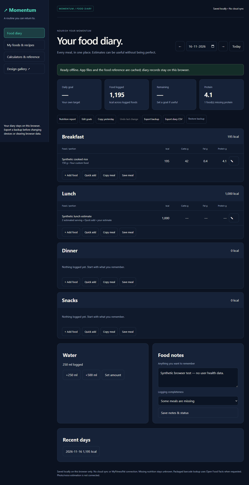
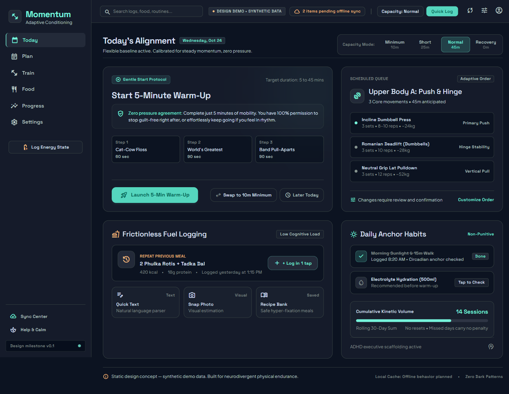
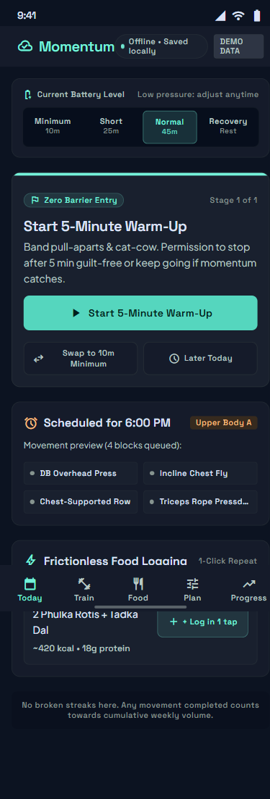

# Project Momentum

[](https://github.com/Thatweirdguy1/Project-Momentum/actions/workflows/validate.yml)

**A calmer fitness workspace: one next action, honest estimates, and a way back after missed days.**

[Open the HTTPS food diary](https://thatweirdguy1.github.io/Project-Momentum/web/diary.html) on Windows or iPhone. Each browser has its own local diary; devices do not synchronize. Export a backup to move records between them.

This build includes a persistent local food diary, calculator/reference workspace and original dark web/iPhone designs. It is **not** the complete native iPhone/Apple Watch/Windows ecosystem. No cloud account, HealthKit, sync or workout recorder is connected.



## What is included

- **A working meal-based food diary**: portion search/review, recent/frequent/favorite foods, quick add, edit/delete/undo, meal copying, saved meals, custom foods, cooked-yield recipes, nutrient reports, manual goals, water, notes, history, backup/restore and offline browser storage. [Food diary capabilities and limits](docs/FOOD_DIARY.md).

- **28 local calculator categories** covering fitness, nutrition, reproductive calendars and selected health reference equations. Inputs stay in browser memory; visible methods and limits accompany results. [Supported methods](docs/CALCULATORS.md).
- **13,649 USDA foods** with calories/macros and **1,019,278 nutrient observations**, source IDs/versions, explicit units and quality flags. [Data details](docs/NUTRITION_DATA.md).
- **1,324 exercise text records in ten languages**, with equipment search and English/Hindi/other translated instructions under the upstream MIT text license. No separately licensed images/GIFs are shipped. [Exercise sources](docs/EXERCISE_DATA.md).
- **904 public exercise-directory references** collected across JEFIT, Muscle & Strength and ACE, with bounded crawl coverage and 24 representative detail inspections.
- **Six desktop + four iPhone concepts**, reviewed HTML, PNG screenshots and a shared dark design system. [Design gallery](design/index.html) · [Google Stitch project](https://stitch.withgoogle.com/projects/6081622018842562931) (connected Google account required).
- Sanitized competitor research and a requirement/acceptance map. The original private memorandum and personal context are excluded from Git and release assets.

The supplied INDB workbook was also collected: **1,014 recipes**, with per-100g and per-source-serving macros and full local nutrient extraction. Its redistribution license remains unresolved, so those rows stay local; reproducible download/import scripts are included. WHO's supplied page is a surveillance/database directory, not a food macro table.

## Run locally

No Node package install or build step is needed for the workspace:

```powershell
git clone https://github.com/Thatweirdguy1/Project-Momentum.git
cd Project-Momentum
python -m http.server 8765 --bind 127.0.0.1
```

Open [the food diary](http://127.0.0.1:8765/web/diary.html), [calculators/reference tools](http://127.0.0.1:8765/web/tools.html), or [the design gallery](http://127.0.0.1:8765/design/index.html). Use HTTP rather than double-clicking files. Local diary storage is specific to your browser/profile/origin; export backups before clearing browser data or moving devices. Offline launch/search works after successful first caching. Barcode lookup requires network access and is optional. Stitch HTML concepts separately reference external fonts/Tailwind CDNs.

Calculator results are informational estimates, not diagnosis, treatment, medication dosing, fertility confirmation or driving/sobriety clearance. All 28 categories are implemented with the selected methods documented; complete Calculator.net option parity is not claimed. Nothing automatically changes calorie targets, training plans or saved health records.

## Screens

| Desktop Today concept | iPhone Today concept |
| --- | --- |
|  |  |

The gallery also includes weekly planning, training editing, Indian recipe/meal review, progress, privacy and missed-day recovery. The companion workspace adds functioning local calculations and searchable source data.

## Research and evidence

Start with [competitor research](docs/RESEARCH.md), [sanitized requirements](docs/REQUIREMENTS.md), [nutrition provenance](docs/NUTRITION_DATA.md), [exercise provenance/licensing](docs/EXERCISE_DATA.md), [calculator methods and REA scope](docs/CALCULATORS.md), [validation](docs/VALIDATION.md) and [known limitations](docs/KNOWN_LIMITATIONS.md).

Scrapling collected public material. REA inspected a bounded selection of public calculator scripts statically. No competitor native binary was supplied or inspected, and no connected Android device was available. Complete commercial food databases, paid programs and in-app videos were not extracted. Native integration and the memorandum's A01–A10 system tests remain future work.

## Checks

```powershell
node web/calculators/engine.test.mjs
node web/diary-model.test.mjs
node web/barcode.test.mjs
python scripts/validate_artifacts.py
```

CI runs these checks on pushes and pull requests. Browser form checks exercised every local calculator, exercise filtering/language rendering and food search. See validation notes for the limits of those checks.

## Repository layout

```text
web/                 Functional local calculators and reference explorers
design/              Reviewed Stitch HTML, screenshots, gallery and design system
data/nutrition/      Public USDA tables, source manifests and quality flags
data/exercises/      MIT text dataset, upstream notices and public directory facts
docs/                Research, requirements, formulas, validation and limits
research/            Public metadata inventories (raw captures excluded)
scripts/             Reproducible collection, normalization and artifact checks
```

Collection scripts require the packages in `requirements-data.txt`; serving the existing files does not. USDA data are CC0/public domain; upstream exercise text is MIT with a media exception. See [THIRD_PARTY_NOTICES.md](THIRD_PARTY_NOTICES.md). No blanket license is asserted over third-party material.
